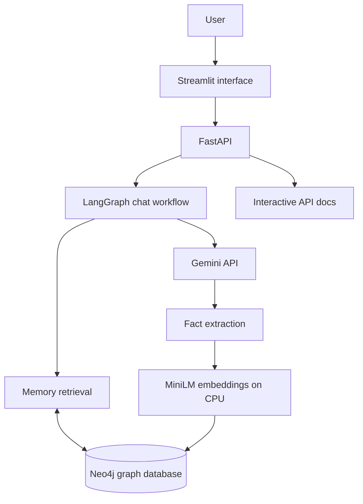

# Agentic AI Memory System

An AI assistant that can remember useful facts from conversations, connect related information, and retrieve those facts later. Memories are stored in **Neo4j as a graph**, so people, projects, technologies, and their relationships can be explored visually.

## Project objectives

- Store important facts from user conversations as structured graph memories.
- Retrieve relevant memories to give the assistant useful context.
- Recognize repeated facts and updates, and keep older facts as history when they are replaced.
- Let users inspect and retract saved facts.
- Provide a chat interface, API documentation, tests, and a repeatable demo.

## Architecture



### Main components

| Component | Role |
| --- | --- |
| **Streamlit** | Provides the chat interface, saved-memory view, and graph visualization. |
| **FastAPI** | Exposes the application's HTTP endpoints and connects the interface to the backend. |
| **LangGraph** | Coordinates the multi-step chat workflow. |
| **Gemini API** | Generates chat responses and extracts facts from messages. |
| **MiniLM (384 dimensions)** | Converts text into embeddings for semantic matching and retrieval. The model runs locally on CPU after download. |
| **Neo4j** | Stores entities and relationships as a graph and supports memory search. |
| **Docker Compose** | Runs Neo4j locally in a container. |
| **Pytest** | Runs automated tests for key memory and API behavior. |

### How memory works

1. A user sends a message through the chat interface or API.
2. The chat workflow retrieves relevant active memories from Neo4j.
3. Gemini generates an answer using the message and retrieved context.
4. The system extracts durable facts from the message.
5. Entities are matched against existing graph data; MiniLM embeddings help find semantically similar items.
6. The memory service creates or connects facts, reinforces repeated information, enriches existing information, or marks replaced facts as superseded.
7. The updated graph can be viewed in the interface or Neo4j Browser.

Memory is scoped by user ID. Similarity scores are ranking signals, not guaranteed probabilities. A deleted fact is marked as deleted rather than physically erased from the database.

## Requirements

- Python 3.11 or 3.12 recommended
- Docker Desktop
- A Gemini API key from [Google AI Studio](https://aistudio.google.com/apikey)
- Internet access to install packages, download the embedding model, and call Gemini
- Recommended: 8 GB RAM and 3–5 GB free disk space

## Setup — macOS/Linux

Run the commands from the repository root.

### 1. Configure environment variables

```bash
cp .env.example .env
```

Edit `.env` and set your own Gemini API key and local Neo4j password:

```dotenv
GEMINI_API_KEY=your_google_ai_studio_key
NEO4J_PASSWORD=choose_a_local_password
```

Keep `.env` private. Do not commit it to GitHub.

### 2. Start Neo4j

Make sure Docker Desktop is running, then run:

```bash
docker compose up -d
docker compose ps
```

Wait until the Neo4j container reports a healthy status.

### 3. Create a Python environment and install dependencies

```bash
python3 -m venv .venv
source .venv/bin/activate
python -m pip install --upgrade pip
python -m pip install -r requirements.txt
```

### 4. Download the embedding model

```bash
python scripts/download_model.py
```

The model is saved locally under `models/all-MiniLM-L6-v2` and loaded from disk when the application runs.

### 5. Check configuration and start the API

```bash
python scripts/check_setup.py
python -m uvicorn main:app --host 127.0.0.1 --port 8000 --workers 1
```

Keep this terminal open while using the app.

### 6. Start the frontend

Open a second terminal in the repository:

```bash
source .venv/bin/activate
python -m streamlit run frontend.py
```

Open the local URL shown by Streamlit, usually http://localhost:8501.

## Setup — Windows PowerShell

Start Docker Desktop, then run these commands in the repository folder:

```powershell
Copy-Item .env.example .env
notepad .env
py -3.12 -m venv .venv
.\.venv\Scripts\Activate.ps1
python -m pip install --upgrade pip
python -m pip install -r requirements.txt
python scripts/download_model.py
python scripts/check_setup.py
python -m uvicorn main:app --host 127.0.0.1 --port 8000 --workers 1
```

In a second PowerShell window:

```powershell
.\.venv\Scripts\Activate.ps1
python -m streamlit run frontend.py
```

If Python 3.12 is unavailable, use Python 3.11. If PowerShell blocks environment activation, run `Set-ExecutionPolicy -Scope Process Bypass` in that terminal and retry.

## Useful URLs

| URL | Purpose |
| --- | --- |
| http://127.0.0.1:8501 | Streamlit application |
| http://127.0.0.1:8000/docs | Interactive FastAPI / Swagger documentation |
| http://127.0.0.1:7474 | Neo4j Browser |
| http://127.0.0.1:8000/ready | API and database readiness check |

## API overview

The interactive API documentation at `/docs` lists request and response schemas and lets you try endpoints.

| Method | Endpoint | Purpose |
| --- | --- | --- |
| `POST` | `/chat` | Send a chat message and receive an answer with relevant memories. |
| `POST` | `/users/{user_id}/memories` | Extract and store facts from a message. |
| `POST` | `/users/{user_id}/memories/search` | Search memories using a text query. |
| `GET` | `/users/{user_id}/memories` | List saved facts. |
| `GET` | `/users/{user_id}/graph` | Retrieve graph nodes and relationships for visualization. |
| `DELETE` | `/users/{user_id}/memories/{fact_id}` | Mark a fact as deleted. |

### Example: store a memory

```http
POST /users/user_101/memories
Content-Type: application/json
```

```json
{
  "message": "I'm building TaskFlow using Python and FastAPI."
}
```

### Example: search memories

```http
POST /users/user_101/memories/search
Content-Type: application/json
```

```json
{
  "query": "What technologies does TaskFlow use?",
  "top_k": 5,
  "include_history": false
}
```

### Example: chat

```json
{
  "user_id": "user_101",
  "session_id": "my-first-session",
  "message": "Which technologies am I using for TaskFlow?"
}
```

Send this object to `POST /chat`. Exact extracted facts and response values depend on the message and model output.

## Demonstration

With Neo4j, the API, and Streamlit running:

1. Open the Streamlit app and use the same User ID for each message.
2. Send: `I'm building TaskFlow using Flask. I prefer dark mode.`
3. Send: `TaskFlow is a Flask-based project.`
4. Send: `I switched TaskFlow from Flask to FastAPI.`
5. Ask: `What framework does TaskFlow use now?`

The repeated fact should reinforce existing memory, and the explicit framework change should mark the previous fact as superseded. Results depend on model output and should be checked in the saved-memory view.

You can also run the demo script from the repository root:

```bash
python scripts/demo.py
```

### View the graph in Neo4j Browser

Open http://127.0.0.1:7474 and sign in with username `neo4j` and the password configured in `.env`. Then run:

```cypher
MATCH p = (u:User {user_id: 'user_101'})-[:HAS_ENTITY]->(e:Entity)
OPTIONAL MATCH q = (e)-[r:FACT]-(other)
WHERE r.user_id = 'user_101' AND r.status = 'active'
RETURN p, q LIMIT 100;
```

Use the same User ID as your chat session. If you used another ID, replace `user_101` in the query.

## Tests

Install development dependencies and run the test suite:

```bash
python -m pip install -r requirements-dev.txt
python -m pytest -q
```

Tests cover memory behavior and API contracts. Unit tests do not replace a live test with valid Gemini credentials and a running Neo4j instance; run the demo script for an end-to-end check.

## Project structure

```text
.
├── main.py
├── frontend.py
├── app/
│   ├── agent.py
│   ├── router/
│   │   ├── chat.py
│   │   └── memory.py
│   ├── memory/
│   │   └── short_term.py
│   └── graph_memory/
│       ├── config.py
│       ├── database/
│       │   ├── neo4j_client.py
│       │   └── schema.cypher
│       ├── models/
│       │   └── schemas.py
│       └── services/
│           ├── memory_extractor.py
│           ├── embedding_service.py
│           ├── entity_resolver.py
│           ├── relationship_resolver.py
│           ├── memory_manager.py
│           └── memory_retriever.py
├── scripts/
│   ├── check_setup.py
│   ├── download_model.py
│   ├── demo.py
│   ├── start.sh
│   └── start.ps1
├── tests/
├── compose.yaml
├── .env.example
├── requirements.txt
└── requirements-dev.txt
```

## Configuration and security notes

- Configuration is stored in `.env`; keep real keys and passwords out of source control.
- The default services bind to the local machine. Do not expose this prototype publicly without adding appropriate authentication and deployment security.
- If `AUTH_TOKEN` is configured, protected requests use the `X-API-Key` header. This is a shared token, not individual user authentication.
- Deleted facts are soft-deleted; this is not secure physical erasure.
- Stop the API and Streamlit with `Ctrl+C`. Stop Neo4j with `docker compose down`. Avoid `docker compose down -v` unless you intentionally want to remove the persistent database volume.

## References

- [Neo4j vector indexes](https://neo4j.com/docs/cypher-manual/current/indexes/search-indexes/vector-indexes/)
- [Gemini API](https://ai.google.dev/gemini-api/docs)
- [Sentence Transformers](https://sbert.net/)
- [FastAPI](https://fastapi.tiangolo.com/)
