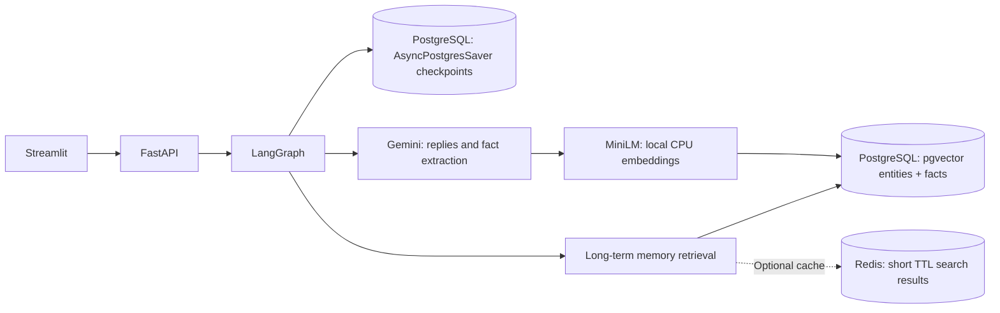

# Agentic AI Memory System — LangGraph + PostgreSQL + optional Redis

LangGraph chat memory now survives API restarts using **`AsyncPostgresSaver`**.
Long-term entities, atomic facts, corrections, and the graph-view API are stored
in **PostgreSQL with pgvector** rather than Neo4j. **Redis is optional** and
caches expensive semantic search responses; PostgreSQL remains the only durable
source of truth. The existing FastAPI routes and Streamlit UI remain available.

## Architecture



**Why two PostgreSQL persistence layers?** LangGraph's checkpointer only
persists **per-thread graph state** (messages, workflow state, interrupts). It
is *not* a general multi-user semantic memory database. The relational tables
`memory_users`, `memory_entities`, and `memory_facts` persist cross-session facts
with deletion, reinforcement, replacement, graph rendering and similarity
search. The graph visualization is assembled from PostgreSQL relations, not
from Neo4j. A Redis checkpointer is deliberately *not* run alongside Postgres:
it would create competing checkpoint authorities.

## Requirements

- Python 3.11 or 3.12 recommended
- Docker with Docker Compose, or existing PostgreSQL 16+ with pgvector installed
- Google Gemini API key (model availability and quotas may change)
- Internet for dependency/model download and Gemini inference
- Recommended: at least 8 GB RAM (the MiniLM model runs locally on CPU)

## Quick start

Run commands from the repo root:

```bash
cp .env.example .env
# Edit .env: set GEMINI_API_KEY, POSTGRES_PASSWORD and matching POSTGRES_DSN.
# Keep .env out of Git.
docker compose up -d                    # PostgreSQL with pgvector
python3 -m venv .venv
source .venv/bin/activate
python -m pip install --upgrade pip
python -m pip install -r requirements.txt
python scripts/download_model.py
python scripts/check_setup.py
python -m uvicorn main:app --host 127.0.0.1 --port 8000 --workers 1
```

Start the existing frontend in another terminal:

```bash
source .venv/bin/activate
python -m streamlit run frontend.py
```

- API docs: <http://127.0.0.1:8000/docs>
- Readiness probe: <http://127.0.0.1:8000/ready>
- Streamlit UI: <http://localhost:8501>

Startup initializes the pgvector schema, runs `AsyncPostgresSaver.setup()`
(checkpoint migrations) and compiles LangGraph using the live saver. The
application's PostgreSQL account needs `CREATE`/DDL privileges during initial
setup. For a production deployment, run schema migrations separately with one
migrator; do not let multiple replicas migrate simultaneously.

### Enable Redis (optional)

```bash
docker compose --profile redis up -d
```

In `.env`, set:

```dotenv
REDIS_URL=redis://127.0.0.1:6379/0
REDIS_CACHE_TTL_SECONDS=60
```

Restart the API. If Redis becomes unavailable, memory retrieval automatically
falls back to PostgreSQL; conversation checkpoints are unaffected. Redis keys
use hashed user IDs and query text, and cached results expire. The cache
version is bumped whenever facts are created, changed, or soft-deleted. Treat
Redis as confidential storage because *values* still contain user facts.

### Configuration

| Setting | Purpose |
| --- | --- |
| `POSTGRES_DSN` | PostgreSQL connection string for **both** checkpoints and long-term facts. URL-encode special password characters. |
| `POSTGRES_PASSWORD`, `POSTGRES_USER`, `POSTGRES_DB` | Local Docker service credentials/database; keep DSN consistent. |
| `PG_POOL_MIN_SIZE`, `PG_POOL_MAX_SIZE` | Pooled psycopg connections for checkpointer and memory store (defaults 1/10). |
| `REDIS_URL` | Empty = Redis disabled; otherwise cache only. |
| `REDIS_CACHE_TTL_SECONDS` | Search cache expiration in seconds (default 60). |
| `GEMINI_API_KEY`, `GEMINI_MODEL` | Gemini provider credentials/model. |
| `EMBEDDING_MODEL_PATH` | On-disk 384-dimensional MiniLM model. |
| `AUTH_TOKEN` | Optional **shared** API key for local demos; not user authentication. |

### Existing APIs (preserved)

| Method | Route | Behavior |
| --- | --- | --- |
| `POST` | `/chat` | Chat using persistent LangGraph thread memory; retrieve/ingest cross-session facts. |
| `POST` | `/users/{user_id}/memories` | Extract and ingest facts. |
| `GET` | `/users/{user_id}/memories` | List active facts, optionally superseded history. |
| `POST` | `/users/{user_id}/memories/search` | Vector similarity search with optional Redis cache. |
| `GET` | `/users/{user_id}/graph` | Render entities and relationships from SQL rows. |
| `DELETE` | `/users/{user_id}/memories/{fact_id}` | Soft-delete one fact; invalidate cached results. |
| `GET` | `/users/{user_id}/sessions/{session_id}` | **New**: retrieve a session's saved messages, including after API restarts. |
| `DELETE` | `/users/{user_id}/sessions/{session_id}` | **New**: permanently remove one thread's checkpoints/history; long-term facts are unchanged. |

The `/chat` JSON contract is unchanged:

```json
{
  "user_id": "user_101",
  "session_id": "first-conversation",
  "message": "Do you remember which framework I use?"
}
```

The same `(user_id, session_id)` pair resumes the same PostgreSQL thread,
including after a process restart. A different `session_id` starts a distinct
conversation, while fact memory remains accessible across that user's sessions.
The sidebar can load an earlier conversation using the saved Session ID.
A deterministic SHA-256 hash maps the pair to a bounded, opaque `thread_id`.
Business service clients are passed as **LangGraph runtime context**, never
serialized in the checkpoint.

### Memory retention, removal and safety

- **Fact delete is a soft delete**; the record remains in PostgreSQL for audit
  unless separately purged. Deleted/superseded facts are excluded from active
  retrieval but may also appear in **prior chat checkpoints**. Full erasure
  requires cleaning both the fact records and affected thread checkpoints.
- **Session delete** uses `AsyncPostgresSaver.adelete_thread`, removing that
  session's checkpoint history but **not** extracted long-term facts.
- Checkpoint snapshots grow with ongoing chats. The Gemini prompt uses the last
  10 chat messages; configure pruning/compaction or state summarization for
  sustained production conversations.
- The per-user ingestion lock and per-thread chat/delete lock serialize work
  **within one FastAPI process**. Before using multiple replicas, add a
  distributed lock or serialize runs by `thread_id` and fact ingestion by `user_id`.
- PostgreSQL uses exact cosine ordering **after user scoping** for reliability;
  for high-cardinality production datasets, benchmark per-tenant partitioning,
  pgvector ANN indexes and query plans before enabling global HNSW indexes.
- `/chat` rejects easily detected credentials before durable checkpointing;
  this heuristic is not complete DLP. Never submit sensitive secrets.
- Protect PostgreSQL/Redis with network restrictions, TLS, credentials and
  backups. Redis here is an ephemeral cache with no disk persistence.
- The optional `AUTH_TOKEN` is shared between users; do **not** publish this
  example as a multi-tenant public API without real authentication and
  authorization mapped to `user_id`.

## Migrating existing Neo4j data

**Applying this code patch does not migrate or delete Neo4j data.** All new
facts are written to PostgreSQL. If you need prior Neo4j memories, export
user-scoped entities/facts (including embeddings and superseding status),
import into the matching PostgreSQL tables while retaining IDs, and compare
per-user counts *before* decommissioning Neo4j. If you do not require the old
facts, start with an empty PostgreSQL database. The old in-process chat buffer
was ephemeral and cannot be recovered after the earlier API exits.

## Tests and demo

```bash
python -m pip install -r requirements-dev.txt
python -m pytest -q
python scripts/demo.py
```

Database-backed integration tests run only when `POSTGRES_TEST_DSN` is set to an
isolated PostgreSQL database with pgvector. They use randomized user/thread IDs
and test persistence/restart behavior. Unit tests use fake dependencies and do
not require Gemini, Redis, or PostgreSQL. Smoke-test with a real Gemini key
before production use.

### References

- [LangGraph persistence: checkpoints vs. stores](https://docs.langchain.com/oss/python/langgraph/persistence)
- [AsyncPostgresSaver reference](https://reference.langchain.com/python/langgraph.checkpoint.postgres/aio/AsyncPostgresSaver)
- [LangGraph runtime context](https://reference.langchain.com/python/langgraph/runtime/Runtime)
- [pgvector](https://github.com/pgvector/pgvector)
- [Redis for LangGraph (alternative checkpoint backend; not used here)](https://github.com/redis-developer/langgraph-redis)
