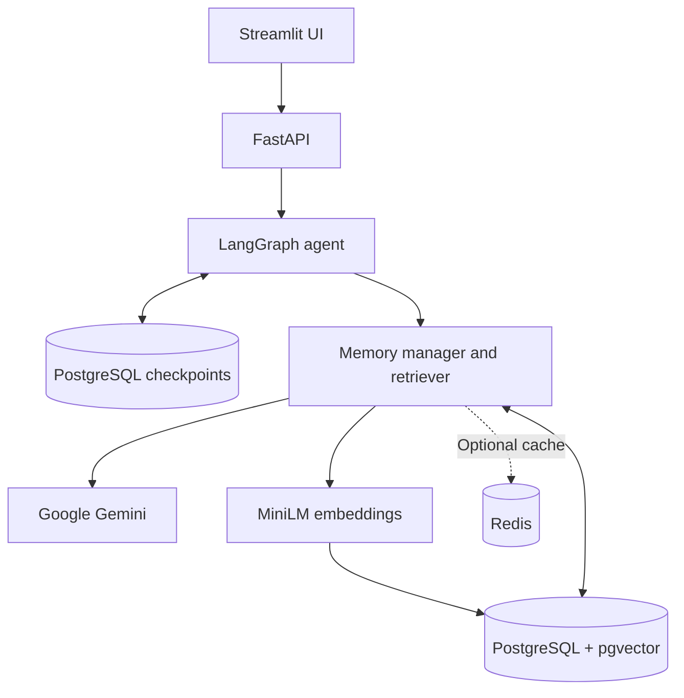

# Agentic AI Memory System

An AI chat application that remembers useful facts about users across conversations. It combines LangGraph, FastAPI, Google Gemini, PostgreSQL with pgvector, local MiniLM embeddings, and an optional Redis cache.

## Features

- Chat with the AI through a Streamlit interface or REST API.
- Save conversation state using LangGraph checkpoints in PostgreSQL.
- Extract and store long-term facts for each user.
- Retrieve relevant facts using vector similarity search.
- Update facts when information changes and mark older facts as superseded.
- View saved facts and their relationships in a memory graph.
- Search faster with optional Redis caching.
- View or delete conversation sessions and delete individual saved facts.

## Architecture



### Main components

| Component | Responsibility |
| --- | --- |
| **LangGraph** | Runs the chat workflow and manages conversation state. |
| **PostgreSQL checkpoint saver** | Persists messages and workflow state for each user/session conversation. |
| **PostgreSQL + pgvector** | Stores user-scoped entities and facts and supports semantic search. |
| **Google Gemini** | Generates chat responses and extracts facts from messages. |
| **MiniLM** | Creates 384-dimensional text embeddings locally on the machine. |
| **Redis (optional)** | Temporarily caches memory-search results. PostgreSQL remains the durable storage. |
| **FastAPI** | Exposes chat and memory endpoints. |
| **Streamlit** | Provides a browser-based chat, memory list, and graph interface. |

**Conversation checkpoints** keep the messages for a particular session. **Long-term memory** stores facts that can be retrieved across that user's sessions.

## Requirements

- Python 3.11 or newer
- Docker with Docker Compose
- Google Gemini API key
- Internet connection for installing packages, downloading the MiniLM model, and Gemini requests
- Recommended: 8 GB RAM

## Setup

Run the commands from the repository folder.

### 1. Configure environment variables

macOS/Linux:

```bash
cp .env.example .env
```

Windows PowerShell:

```powershell
Copy-Item .env.example .env
```

Open `.env` and set `GEMINI_API_KEY`. Set a local `POSTGRES_PASSWORD` and make sure `POSTGRES_DSN` uses the same username, password, host, port, and database. URL-encode special characters in the DSN password.

### 2. Start PostgreSQL

```bash
docker compose up -d
```

### 3. Install Python dependencies

macOS/Linux:

```bash
python3 -m venv .venv
source .venv/bin/activate
```

Windows PowerShell:

```powershell
python -m venv .venv
.venv\Scripts\Activate.ps1
```

Then run:

```bash
python -m pip install --upgrade pip
python -m pip install -r requirements.txt
python scripts/download_model.py
python scripts/check_setup.py
```

### 4. Start the API and UI

Terminal 1 — API:

```bash
python -m uvicorn main:app --host 127.0.0.1 --port 8000 --workers 1
```

Terminal 2 — Streamlit UI (activate the virtual environment first):

```bash
python -m streamlit run frontend.py
```

Open these URLs:

- **Streamlit UI:** http://127.0.0.1:8501
- **Interactive API docs:** http://127.0.0.1:8000/docs
- **API readiness:** http://127.0.0.1:8000/ready
- **Health check:** http://127.0.0.1:8000/health

At startup, the API initializes the memory tables and LangGraph checkpoint schema. The configured PostgreSQL user must have permission to create the required tables and indexes.

## Optional Redis cache

Redis is optional. The application can run without it.

Start Redis:

```bash
docker compose --profile redis up -d
```

Set these values in `.env`:

```dotenv
REDIS_URL=redis://127.0.0.1:6379/0
REDIS_CACHE_TTL_SECONDS=60
```

Restart the API after changing `.env`. When Redis is disabled or unavailable, memory searches use PostgreSQL without the cache.

## Configuration

| Variable | Purpose |
| --- | --- |
| `GEMINI_API_KEY` | Required API key for Google Gemini. |
| `GEMINI_MODEL` | Gemini model name. |
| `POSTGRES_USER`, `POSTGRES_PASSWORD`, `POSTGRES_DB` | PostgreSQL credentials used by Docker Compose. |
| `POSTGRES_DSN` | Connection string used by the memory store and checkpoint saver. |
| `PG_POOL_MIN_SIZE`, `PG_POOL_MAX_SIZE` | Minimum and maximum pooled database connections. |
| `EMBEDDING_MODEL_PATH` | Local directory for the MiniLM model. |
| `EMBEDDING_DIMENSIONS` | Embedding size; this project uses 384. |
| `REDIS_URL` | Optional Redis connection. Leave empty to disable Redis. |
| `REDIS_CACHE_TTL_SECONDS` | Lifetime of cached search results in seconds. |
| `AUTH_TOKEN` | Optional shared API key. When set, send it in the `X-API-Key` header. |

## API documentation

The interactive Swagger UI at [http://127.0.0.1:8000/docs](http://127.0.0.1:8000/docs) lists request schemas and response formats.

| Method | Endpoint | Purpose |
| --- | --- | --- |
| `POST` | `/chat` | Send a message and receive an AI response using the session's checkpoint state and relevant saved facts. |
| `GET` | `/users/{user_id}/sessions/{session_id}` | Read saved messages for a conversation session. |
| `DELETE` | `/users/{user_id}/sessions/{session_id}` | Delete a session's checkpoint history. Long-term facts remain stored. |
| `POST` | `/users/{user_id}/memories` | Extract and store facts from a message. |
| `GET` | `/users/{user_id}/memories` | List saved facts. Use `include_history=true` to include superseded facts. |
| `POST` | `/users/{user_id}/memories/search` | Search saved facts by semantic similarity. |
| `GET` | `/users/{user_id}/graph` | Return the user's memory graph as nodes and edges. |
| `DELETE` | `/users/{user_id}/memories/{fact_id}` | Remove a fact from active retrieval. |

### Example: chat

Request:

```json
{
  "user_id": "demo_user",
  "session_id": "conversation_1",
  "message": "I am building TaskFlow with FastAPI and prefer dark mode."
}
```

Send it to `POST /chat`. The response includes an `answer`, `relevant_memories`, and `memory_update` status. Reusing the same user and session IDs continues the same conversation.

### Example: memory search

Request to `POST /users/demo_user/memories/search`:

```json
{
  "query": "Which backend framework does TaskFlow use?",
  "top_k": 5
}
```

The response contains the query and a list of relevant memories with their statements and similarity scores.

## Tests

Install development dependencies:

```bash
python -m pip install -r requirements-dev.txt
```

Run the automated tests:

```bash
python -m pytest -q
```

The tests cover:

| Test area | What it checks |
| --- | --- |
| Agent workflow | Retrieval, response generation flow, saved messages, and safe handling of ambiguous forget requests. |
| API contract | Available routes, request/response behavior, authorization, and session operations. |
| Checkpoint configuration | Stable and user/session-specific thread IDs. |
| Redis cache | Cache behavior and fallback-safe operations. |
| Thread locks | Concurrent operations for the same thread. |
| PostgreSQL integration | Fact lifecycle, user isolation, and persistent checkpoint behavior. |

PostgreSQL integration tests are skipped unless `POSTGRES_TEST_DSN` is set to an **isolated test database** with pgvector installed. Never point the test DSN at production data.

## Demonstrate memory

Start PostgreSQL, run setup, and start the API. Then run:

```bash
python scripts/demo.py
```

The demo sends sample facts, updates a project's framework, and searches the memory store. You can also enter messages in Streamlit, inspect the saved facts and graph, and restart the API to demonstrate that session checkpoints are persistent.

## Security notes

- Keep `.env` private and never commit API keys or database passwords.
- Keep the demo API bound to localhost unless proper authentication and authorization are configured.
- `AUTH_TOKEN` is a shared API key, not per-user authentication.
- Use a separate database for integration tests.
- Deleting a session removes its checkpoint history but does not delete that user's long-term facts.
