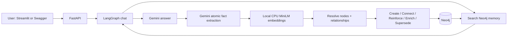

# Agentic AI Memory System — Neo4j Graph Edition

**One user → one connected long-term memory graph.** A lightweight local project based on the original **Agentic-AI-Memory-System** repository, retaining its LangGraph chat agent and Streamlit UI.

You can talk to the assistant, tell it about your projects or preferences, ask it to remember earlier facts, and watch its Neo4j graph grow. Repeating a fact reinforces the same relationship; explicitly correcting a fact preserves the old version as history.

The only service to run in Docker is **Neo4j**. The FastAPI app, Gemini client, and **384-dimensional all-MiniLM-L6-v2 embedding model** run directly on your laptop. Short-term chat messages are held in a small in-process buffer, so **PostgreSQL and Redis are no longer needed**.

## What this patch adds

| Component | How it works |
| --- | --- |
| Chat | Existing `/chat` endpoint and LangGraph workflow retained, now reading/writing graph memory |
| LLM | Gemini API; configurable model, default `gemini-3.5-flash-lite` |
| Embeddings | `sentence-transformers/all-MiniLM-L6-v2`, **384D on CPU**; weights downloaded once |
| Database | Neo4j 2026.02+ with Cypher 25 indexes on nodes **and** relationships |
| Graph schema | Per-user `(User)-[:HAS_ENTITY]->(Entity)` plus `(User|Entity)-[:FACT {predicate: ...}]->(Entity)` |
| Deduplication | Exact-name/alias lookup, semantic candidate search, Gemini identity verification |
| Graph evolution | CREATE · CONNECT · REINFORCE · ENRICH · SUPERSEDE; deleted facts excluded from retrieval |
| History | Replaced facts marked `superseded`; optional historical retrieval |
| Retrieval | Filtered vector search + one-hop graph traversal + ranking |
| UI | Streamlit chat, saved facts, one-click fact retraction, graph visualization |
| Cleanup | FastAPI lifespan startup checks, Neo4j/Gemini/CPU model close, session cleanup on shutdown |

### Flow



## 1. What you need

- **Python 3.11 or 3.12** recommended ([python.org](https://www.python.org/downloads/)). Tick **Add Python to PATH** on Windows.
- **Docker Desktop**, running ([docker.com](https://www.docker.com/products/docker-desktop/)). The Compose file runs **Neo4j only**. Neo4j Desktop/server works as an alternative, see below.
- A **Gemini API key** from [Google AI Studio](https://aistudio.google.com/apikey). Google's free-tier quotas and model availability vary with account/region. The app does **not** automatically switch to a paid model.
- Internet access **once** for Python dependencies and model weights, and later for Gemini API requests. CPU embeddings work offline afterward.
- Recommended laptop: **8 GB RAM or more** and **3–5 GB free disk** (Python/PyTorch/model + Neo4j data and image). Performance varies by laptop.

**Keep Docker and API access on your own laptop.** The default ports are restricted to `127.0.0.1`, and `user_id` is **not** authentication.

## 2. Quick setup — macOS/Linux

Unzip or clone this repo, open Terminal **inside its directory**, then:

**A. Create configuration**

```bash
cp .env.example .env
```

Open `.env` in a text editor and replace these lines with your actual values:

```dotenv
GEMINI_API_KEY=your_google_ai_studio_key
NEO4J_PASSWORD=choose_your_own_local_password
```

Leave the remaining values as they are for your first run. **Never commit or share `.env`.**

**B. Start Neo4j** (make sure Docker Desktop is open)

```bash
docker compose up -d
docker compose ps
```

The first launch downloads the Neo4j image; its health check may take roughly a minute to become healthy.

**C. Create a local Python environment**

```bash
python3 -m venv .venv
source .venv/bin/activate
python -m pip install --upgrade pip
```

On **Linux CPU-only laptops**, optionally install CPU PyTorch before the next command, to avoid large CUDA packages:

```bash
python -m pip install torch --index-url https://download.pytorch.org/whl/cpu
```

On **macOS** no separate PyTorch command is normally required.

**D. Install packages and download the model ONCE**

```bash
python -m pip install -r requirements.txt
python scripts/download_model.py
```

This downloads `sentence-transformers/all-MiniLM-L6-v2` into **`models/all-MiniLM-L6-v2/`** and verifies the **384** output dimensions. At runtime the model is loaded **from local disk, on CPU**, without fetching it again.

**E. Check and run the API**

```bash
python scripts/check_setup.py
python -m uvicorn main:app --host 127.0.0.1 --port 8000 --workers 1 --timeout-graceful-shutdown 30
```

Leave this terminal open. Your API is ready when you see the startup log.

**F. Open the UI** — in a **second terminal** in the same directory:

```bash
source .venv/bin/activate
python -m streamlit run frontend.py
```

Open Streamlit's displayed URL (usually `http://localhost:8501`). You can now chat with the assistant and see memories and the graph.

## 3. Windows (PowerShell) setup

Open PowerShell in the extracted repository. Start Docker Desktop first.

```powershell
Copy-Item .env.example .env
notepad .env
```

Add your Gemini API key and choose a Neo4j password, as in step 2.

```powershell
docker compose up -d
py -3.12 -m venv .venv
.\.venv\Scripts\Activate.ps1
python -m pip install --upgrade pip
python -m pip install -r requirements.txt
python scripts/download_model.py
python scripts/check_setup.py
python -m uvicorn main:app --host 127.0.0.1 --port 8000 --workers 1 --timeout-graceful-shutdown 30
```

If `py -3.12` is not installed, try `py -3.11`. If virtual-environment activation is blocked, enter `Set-ExecutionPolicy -Scope Process Bypass` in that terminal and retry the activation command.

In a **second PowerShell window**:

```powershell
.\.venv\Scripts\Activate.ps1
python -m streamlit run frontend.py
```

## 4. Try it in your browser (no Python required)

| Address | What it does |
| --- | --- |
| [http://127.0.0.1:8501](http://127.0.0.1:8501) | Streamlit chat, saved facts and graph |
| [http://127.0.0.1:8000/docs](http://127.0.0.1:8000/docs) | Interactive API docs; execute endpoints manually |
| [http://127.0.0.1:7474](http://127.0.0.1:7474) | Neo4j Browser graph view |
| [http://127.0.0.1:8000/ready](http://127.0.0.1:8000/ready) | API + database readiness check |

In Streamlit, send these **three messages in order** with the same User ID:

1. `I'm building TaskFlow using Flask. I prefer dark mode.`
2. `TaskFlow is a Flask-based project.`
3. `I switched TaskFlow from Flask to FastAPI.`

The second message should reinforce the Flask fact rather than create another one. The third should create an active FastAPI fact and mark the former Flask fact as superseded. Ask `What framework does TaskFlow use now?` to try retrieval.

Or run the repeatable demo script from the project root:

```bash
python scripts/demo.py
```

For Neo4j Browser, sign in with username `neo4j`, password from your `.env`, then run:

```cypher
MATCH p = (u:User {user_id: 'user_101'})-[:HAS_ENTITY]->(e:Entity)
OPTIONAL MATCH q = (e)-[r:FACT]-(other)
WHERE r.user_id = 'user_101' AND r.status = 'active'
RETURN p, q LIMIT 100;
```

This query shows the root User node, entity nodes, membership edges and active fact edges. If you used `demo_user_123` in Swagger/demo.py, replace the user ID accordingly.

## 5. Memory and chat API

Visit `/docs` and expand the route you want. You can also use curl, Postman or your own client.

### Add a memory

**POST** `/users/{user_id}/memories`

```json
{
  "message": "I'm building TaskFlow using Python and FastAPI.",
  "source_message_id": "msg_optional_unique_id"
}
```

Example response (IDs and extracted facts will vary):

```json
{
  "user_id": "user_101",
  "status": "success",
  "source_message_id": "msg_optional_unique_id",
  "operations": [
    {"action": "CREATE", "entity": "TaskFlow"},
    {"action": "CREATE", "entity": "Python"},
    {"action": "CREATE", "entity": "FastAPI"},
    {"action": "CONNECT", "subject": "TaskFlow", "predicate": "USES", "object": "Python", "fact_id": "..."}
  ]
}
```

A message without a durable fact yields `{"status":"ignored", ...}`. Free-tier Gemini usage may be limited; errors are returned instead of silently fabricating memories.

### Search a memory

**POST** `/users/{user_id}/memories/search`

```json
{
  "query": "What technologies does TaskFlow use?",
  "top_k": 5,
  "include_history": false
}
```

Results include `fact_id`, `statement`, `predicate`, `subject`, `object`, `status`, `score` and `seen_count`. Set `include_history: true` to include superseded facts when asking about past states. `score` is a combined relevance ranking signal, **not** a calibrated probability.

### List saved facts (for Streamlit)

**GET** `/users/{user_id}/memories?limit=100&include_history=false`

### Visualize the graph

**GET** `/users/{user_id}/graph?include_history=false&limit=150`

Returns nodes and edges including `HAS_ENTITY` and `FACT`. The Streamlit graph view uses this endpoint.

### Delete/retract one fact

**DELETE** `/users/{user_id}/memories/{fact_id}`

This marks the fact `deleted`, removes it from active and historical memory-search results, and leaves an internal record. It is **soft deletion**, not secure erasure. For irreversible data erasure a separate purge workflow would be required. The chat can also forget **one unambiguous, literally matching fact**, but for precise deletion use this endpoint or the Streamlit **Forget this fact** button.

### Chat via LangGraph

**POST** `/chat`

```json
{
  "user_id": "user_101",
  "session_id": "my-first-session",
  "message": "Which technologies am I using for TaskFlow?"
}
```

Returns `answer`, `relevant_memories` and `memory_update`. The agent retrieves relevant facts, sends them to Gemini as contextual background, stores the conversation turn in local short-term memory, and extracts any **new** durable facts afterward. If extraction fails, an already generated chat answer is preserved, and `memory_update` indicates the issue.

## 6. Settings you can edit

All settings live in `.env`:

```dotenv
GEMINI_API_KEY=your_key
GEMINI_MODEL=gemini-3.5-flash-lite
NEO4J_URI=bolt://127.0.0.1:7687
NEO4J_USER=neo4j
NEO4J_PASSWORD=your_local_password
NEO4J_DATABASE=neo4j
EMBEDDING_MODEL_PATH=models/all-MiniLM-L6-v2
EMBEDDING_DIMENSIONS=384
ENTITY_SIMILARITY_FLOOR=0.78
FACT_SIMILARITY_FLOOR=0.68
MAX_FACTS_PER_MESSAGE=15
STARTUP_INDEX_WAIT_SECONDS=90
AUTH_TOKEN=
```

If you fill `AUTH_TOKEN`, protected memory and chat requests must include an `X-API-Key` header with that token. The Streamlit UI reads the same token from `.env` automatically. This is only a **single shared laptop token**, **not** per-user authorization. Do not bind this prototype to a public network interface.

A lower similarity threshold finds more possible duplicates but triggers more Gemini equivalence checks and can increase false merges. Start with the provided values and adjust only after testing your data.

The model path must contain the downloaded **384D MiniLM model**. Changing `EMBEDDING_DIMENSIONS` or switching embedding models requires a deliberate migration/reindexing of existing Neo4j embeddings; simply changing `.env` is not sufficient.

## 7. How memory decisions are made

1. Gemini extracts atomic subject-predicate-object facts from the latest user message (or returns an empty list).
2. Each entity is normalized and resolved against **only this user's** graph using exact matches, aliases and nearest-vector candidates.
3. Gemini verifies ambiguous entity identity instead of trusting embedding similarity by itself.
4. Fact resolution compares the subject, predicate, object, timeframe, context and semantically similar existing relationships.
5. The service chooses **CREATE, CONNECT, REINFORCE, ENRICH or SUPERSEDE** and commits all changes for the message in **one Neo4j transaction**.
6. Semantic retrieval uses filtered vector search plus one-hop graph expansion. Active facts are preferred; history is opt-in.

A Flask-to-FastAPI *explicit switch* supersedes the old fact; saying the project "also uses Redis" adds a new relationship. Python and FastAPI remain distinct entities; similarity alone is never treated as entity equivalence. User IDs are included in every entity/fact query to prevent accidental cross-user graph matches.

## 8. Startup, shutdown and keeping your data

- **Startup** verifies Neo4j connectivity, creates constraints/indexes, waits for vector indexes to become available, loads MiniLM locally on CPU, then initializes Gemini and the agent.
- **Graceful shutdown:** press **Ctrl+C** in the API terminal. FastAPI closes Gemini's client, releases the local model, closes Neo4j connections and clears temporary chat history.
- **Stop the Streamlit UI:** press **Ctrl+C** in its terminal.
- **Stop Neo4j:** `docker compose down` (your graph **remains** in the named Docker volume).
- **Start again:** `docker compose up -d`, activate `.venv`, rerun `uvicorn` and `streamlit`.
- **Do not run `docker compose down -v`** unless you intentionally want to erase the Neo4j data volume.
- Use `--workers 1`: locks and chat buffer are designed for **one laptop process**, not a multi-worker deployment.

Convenience API scripts after setup: `sh scripts/start.sh` (macOS/Linux) or `./scripts/start.ps1` (PowerShell).

## 9. Tests

Core tests do not require Gemini credentials, Neo4j, Docker, model downloads or a network connection. With a Python environment containing dev dependencies:

```bash
python -m pip install -r requirements-dev.txt
python -m pytest -q
```

Tests cover entity alias reuse, duplicate reinforcement, explicit replacement, additive facts, user isolation, historical retrieval, same-fact/different-timeframe handling, concurrent ingestion, secret rejection and in-memory session behavior. **A passing unit suite does not replace a live Gemini/Neo4j smoke test.** Run `scripts/demo.py` after you start the services.

## 10. What changed compared with the original repository

| Original | After this patch |
| --- | --- |
| PostgreSQL + pgvector long-term memory | Neo4j `User`/`Entity` nodes and `FACT` relationships |
| Gemini API embedding (`768D`) | Local CPU MiniLM (`384D`) — **no embedding API cost** |
| Redis for short-term messages | Local bounded, 24-hour in-process buffer |
| Flat CRUD `/memories/...` endpoints | User-scoped graph memory APIs `/users/{user_id}/...` |
| LangGraph chat | **Retained**, now wired into graph retrieval/ingestion |
| Streamlit chat | **Retained**, plus graph exploration and fact retraction |

**Existing data is not auto-migrated.** If you already saved facts in PostgreSQL or Redis, those services remain untouched but this version does not read from them. Export the data first if you intend to migrate it; this patch does not silently delete your old database. Former `/memories/` CRUD endpoints were replaced by the new graph API: update any external clients accordingly. Existing uncommitted repo modifications should be committed or stashed before applying the patch.

## 11. Without Docker

Use a local **Neo4j 2026.02 or later** installation (Neo4j Desktop or server). Start the database, set `NEO4J_URI`, `NEO4J_USER` and `NEO4J_PASSWORD` in `.env`, then continue with the Python installation. **Older Neo4j versions lack the required Cypher 25 filtered vector `SEARCH` syntax.**

## 12. Troubleshooting

| Problem | Fix |
| --- | --- |
| `docker compose` not found | Install/start Docker Desktop; reopen Terminal |
| Neo4j says authentication failed | Check `.env` password; if the volume already exists, use its **original** password (changing env does not reset existing credentials) |
| API fails to start with `model not found` | Run `python scripts/download_model.py` after `pip install` |
| Torch downloads large CUDA packages on Linux | Install CPU Torch with the official `https://download.pytorch.org/whl/cpu` wheel index *before* requirements |
| `ModuleNotFoundError` | Activate `.venv` and run `python -m pip install -r requirements.txt` |
| Neo4j vector index not online | `docker compose ps`, wait for the Neo4j health check; run `python scripts/check_setup.py` |
| Gemini 429 / quota exceeded | Check your free-tier quota at [Google AI Studio](https://aistudio.google.com/); retry later or configure another model you have access to |
| Gemini 403 / no access | Verify the API key, project model access and regional restrictions |
| `422` secret input blocked | Remove credentials/passwords from the text before storing a memory |
| UI shows nothing | Open `http://127.0.0.1:8000/ready`; check API terminal logs, user ID and `.env` |
| Graph has no results | Make sure `user_id` matches the one you chatted with or used in the demo |
| On Windows PowerShell `.ps1` is blocked | Run `Set-ExecutionPolicy -Scope Process Bypass` for that terminal session |
| Docker Neo4j data disappeared | Check whether the named volume was removed with `down -v` |

## 13. Files to know

```text
Agentic-AI-Memory-System-main/
├── main.py                        # FastAPI lifespan, routes, readiness/shutdown
├── frontend.py                    # Streamlit chat and interactive graph view
├── app/
│   ├── agent.py                   # LangGraph agent and graph-memory integration
│   ├── router/
│   │   ├── chat.py                # POST /chat
│   │   └── memory.py              # Graph memory REST API
│   ├── memory/
│   │   └── short_term.py          # 20-message/24h local conversation buffer
│   └── graph_memory/
│       ├── config.py
│       ├── database/
│       │   ├── neo4j_client.py    # user-scoped Cypher and atomic transaction
│       │   └── schema.cypher      # constraints and vector indexes
│       ├── models/schemas.py      # validated fact/request/response models
│       └── services/
│           ├── memory_extractor.py
│           ├── embedding_service.py
│           ├── entity_resolver.py
│           ├── relationship_resolver.py
│           ├── memory_manager.py
│           └── memory_retriever.py
├── scripts/
│   ├── download_model.py          # one-time local model download
│   ├── check_setup.py             # offline-friendly diagnostics
│   ├── demo.py                    # optional end-to-end smoke test
│   ├── start.sh
│   └── start.ps1
├── tests/
├── compose.yaml                   # Neo4j container and persistent volume
├── .env.example
├── requirements.txt
└── README.md
```

**Useful official references:** [Neo4j vector search](https://neo4j.com/docs/cypher-manual/current/indexes/search-indexes/vector-indexes/), [Google Gemini API](https://ai.google.dev/gemini-api/docs), [Sentence Transformers](https://sbert.net/), [FastAPI lifespan](https://fastapi.tiangolo.com/advanced/events/).

> **Prototype security note:** do not store secrets or confidential personal data in this demo, use a trusted machine, and do not expose the API or Neo4j ports publicly. The secret-blocking rules are basic safeguards, not comprehensive data-loss prevention or user authentication.
